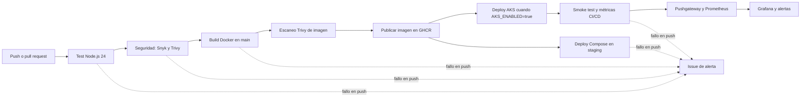

# DevOps 007D OLS — EP3: Observabilidad y entornos reales

## Descripción del servicio

Microservicio HTTP de Node.js instrumentado con `prom-client`. Expone:

- `GET /`: devuelve un mensaje JSON.
- `GET /health`: devuelve el estado de salud en JSON.
- `GET /metrics`: expone métricas Prometheus de solicitudes, errores, latencia y proceso.
- Otras rutas: responden `404`.

Las solicitudes generan logs JSON con timestamp, método, ruta, código de respuesta,
duración e identificador de correlación `X-Request-ID`. El endpoint `/metrics`
expone solicitudes, errores, latencia y métricas del proceso para Prometheus.

## Pipeline CI/CD

El pipeline está definido en [`.github/workflows/ci-cd.yml`](.github/workflows/ci-cd.yml).



### Jobs

- `test`: se ejecuta en todos los pushes y en los pull requests dirigidos a `main`; corre los tests con el runner nativo de Node, exige al menos 80% de cobertura de líneas y publica los reportes HTML, `reports/coverage.txt` y `coverage/lcov.info` como artifacts.
- `security`: depende de `test`; descarga el reporte LCOV, analiza dependencias y código con Snyk, ejecuta Trivy sobre el filesystem y espera el Quality Gate de SonarQube Cloud. Los controles fallidos bloquean los jobs siguientes.
- `build-scan-push`: solo en push a `main`; construye la imagen con etiquetas OCI, la escanea con Trivy y la publica en GHCR bajo el SHA corto del commit.
- `deploy`: solo después de publicar la imagen; selecciona el entorno GitHub `staging`, descarga esa misma imagen por SHA, la levanta con Compose y ejecuta un smoke test HTTP.
- `deploy-aks`: descarga el artifact de cobertura, mide el tiempo del job, despliega en Azure Kubernetes Service, instala Prometheus/Grafana y Pushgateway, y publica métricas de CI/CD después del smoke test.
- `alert`: abre un issue automático en GitHub si falla un job previo en un push.

Los jobs `build-scan-push` y `deploy` solo corren en push a `main`; los jobs `test` y `security` corren para todos los pushes y para pull requests dirigidos a `main`.

## Relación con los 10 pasos del encargo

| Paso | Implementación |
|---|---|
| 01. Dockerfile | [Dockerfile](Dockerfile): build multistage, `node:24-alpine3.24`, `USER node`, `EXPOSE` y `HEALTHCHECK`. [.dockerignore](.dockerignore) excluye archivos innecesarios del contexto de construcción. |
| 02. Compose | [compose.yaml](compose.yaml) ejecuta `app`, `nginx` y el servicio de prueba por perfil. |
| 03. Variables | `.env` local basado en [.env.example](.env.example); `.env` está excluido en [.gitignore](.gitignore). |
| 04. Healthchecks | Healthchecks HTTP para `app` y `nginx` en [compose.yaml](compose.yaml). |
| 05. Orden | NGINX usa `depends_on` con `condition: service_healthy` para `app`. |
| 06. Documentación | Este README documenta ejecución, pipeline, calidad y trazabilidad. |
| 07. Volúmenes | NGINX monta [nginx.conf](nginx.conf) como solo lectura; las pruebas montan `./reports` al host. |
| 08. Tests | [test/basic.test.js](test/basic.test.js) cubre `/health`, `/` y 404 con `node:test`. |
| 09. Automatización | `npm test`, servicio Compose `tests` bajo perfil `test` y workflow GitHub Actions. |
| 10. Reporte | [scripts/generate-report.js](scripts/generate-report.js) genera `reports/test-report.html`; Actions lo publica como artefacto. |

El contenedor `tests` es un proceso de ejecución única, no un servidor HTTP. Los healthchecks HTTP aplican a los servicios de larga ejecución (`app` y `nginx`).

## Indicadores de la Evaluación Parcial N°3

La implementación EP3 se organiza alrededor de los indicadores `IE1`–`IE6`:

- **IE1 — Instrumentación:** `/metrics`, contadores, histograma y `X-Request-ID` en [`src/index.js`](src/index.js), con casos en [`test/basic.test.js`](test/basic.test.js).
- **IE2 — Despliegue seguro en Kubernetes:** réplicas, probes, recursos, usuario no root y etiqueta de imagen por SHA en [`k8s/deployment.yaml`](k8s/deployment.yaml) y [`docs/kubernetes-aks.md`](docs/kubernetes-aks.md).
- **IE3 — Dashboard y señales operacionales:** métricas de servicio/AKS y CI/CD en [`k8s/grafana-dashboard.yaml`](k8s/grafana-dashboard.yaml), descubrimiento en [`k8s/servicemonitor.yaml`](k8s/servicemonitor.yaml) y alertas en [`k8s/prometheus-rules.yaml`](k8s/prometheus-rules.yaml); instalación y Pushgateway en [`.github/workflows/ci-cd.yml`](.github/workflows/ci-cd.yml).
- **IE4 — Documentación de observabilidad:** arquitectura, decisiones, runbook y seguimiento por `request_id` en [`docs/observabilidad-ep3.md`](docs/observabilidad-ep3.md).
- **IE5 — Auditoría de cumplimiento:** controles ejecutables de manifiesto, Trivy, Snyk y cobertura en [`scripts/validate-compliance.js`](scripts/validate-compliance.js), usados por el job `security` de [`.github/workflows/ci-cd.yml`](.github/workflows/ci-cd.yml).
- **IE6 — Falla crítica demostrable:** pasos reproducibles en [`scripts/demo-falla/README.md`](scripts/demo-falla/README.md) y evidencia esperada con espacios para capturas en [`docs/evidence.md`](docs/evidence.md); la rama `demo/falla-critica` se mantiene separada y sin fusionar.

## Política de calidad y seguridad

- Al menos 80% de cobertura de líneas; pruebas fallidas o cobertura insuficiente fallan `npm test` y el job `test`.
- Snyk aplica el umbral `high` a dependencias y análisis de código.
- SonarQube Cloud analiza calidad, mantenibilidad y seguridad estática según `sonar-project.properties`.
- El análisis Sonar importa `coverage/lcov.info` y espera el resultado del Quality Gate antes de dar por exitoso el job `security`.
- Trivy usa `HIGH,CRITICAL` y `exit-code: 1` para filesystem e imagen.
- Los jobs de build y despliegue dependen del job de seguridad exitoso.
- La imagen de runtime contiene solo las dependencias de ejecución declaradas, incluido `prom-client`, y corre como usuario no root.
- La etapa runtime elimina npm y npx, que no son necesarios para ejecutar el servicio; npm permanece disponible en la etapa de pruebas.
- Compose limita memoria/CPU, elimina capabilities y activa `no-new-privileges`; los servicios de aplicación y NGINX usan filesystem de solo lectura.

## Trazabilidad

El SHA corto identifica la imagen publicada en GHCR. La imagen incluye los labels OCI `org.opencontainers.image.revision` y `org.opencontainers.image.source`. El job de despliegue descarga esa imagen por la misma etiqueta y registra el despliegue en el Environment `staging`. El reporte de pruebas queda asociado a la ejecución de Actions como artefacto.

### Despliegue Kubernetes en AKS

La fase 2 incorpora manifiestos Kubernetes en [`k8s/`](k8s/) para desplegar
tres réplicas en Azure Kubernetes Service, con probes HTTP, límites de
recursos, ejecución no root y anotaciones de scraping para `/metrics`.
El workflow ejecuta el job `deploy-aks` cuando la variable de repositorio
`AKS_ENABLED` vale `true`. La configuración de Azure, OIDC, GHCR y el smoke
test está documentada en [`docs/kubernetes-aks.md`](docs/kubernetes-aks.md).

### Observabilidad en AKS

La fase de observabilidad instala `kube-prometheus-stack` y configura:

- Prometheus para recopilar `/metrics` mediante [`k8s/servicemonitor.yaml`](k8s/servicemonitor.yaml).
- Grafana con un LoadBalancer público y el dashboard incluido en [`k8s/grafana-dashboard.yaml`](k8s/grafana-dashboard.yaml).
- Alertas para indisponibilidad, tasa alta de errores y latencia p95 en [`k8s/prometheus-rules.yaml`](k8s/prometheus-rules.yaml).
- Pushgateway (`pushgateway-prometheus-pushgateway`) para publicar cobertura, duración,
  timestamp y resultado de `deploy-aks`. Su ServiceMonitor queda con `honorLabels: true`
  para conservar `job="ci_cd_micro_demo"`.

La arquitectura, los paneles, las consultas PromQL y el procedimiento de respuesta están
documentados en [`docs/observabilidad-ep3.md`](docs/observabilidad-ep3.md).

## Ejecución local

Requiere Node.js 24 o superior para ejecutar el proyecto directamente y Docker con Docker Compose para ejecutar el stack contenedorizado.

```bash
# Instalar las dependencias declaradas en package-lock.json
npm ci

# Ejecutar el servicio directamente en http://localhost:3000
npm start

# Ejecutar pruebas, validar cobertura mínima y generar el reporte HTML
npm test

# Generar solamente el reporte HTML de pruebas
npm run test:report

# Configurar variables para Docker Compose
cp .env.example .env

# Construir la imagen
docker build -t devops-007d-ols:latest .

# Levantar la aplicación y NGINX; el escalamiento se indica explícitamente
docker compose up -d --build --scale app="${APP_REPLICAS:-3}"

# Smoke test local a través de NGINX
curl --fail http://localhost:8080/health

# Ejecutar pruebas dentro del contenedor y escribir el reporte en ./reports
docker compose --profile test run --rm tests
```

El servicio directo utiliza `PORT=3000` por defecto. En Docker Compose, NGINX publica el puerto definido por `NGINX_PORT` (por defecto, `8080`) y reenvía las solicitudes al servicio `app`.

En Linux, configura `TEST_UID` y `TEST_GID` en `.env` con los resultados de `id -u` e `id -g` si el proceso de pruebas no tiene permiso para escribir en `./reports`.

### Variables de entorno

Las variables se pueden definir en `.env` a partir de [.env.example](.env.example):

| Variable | Descripción | Valor predeterminado |
|---|---|---|
| `PORT` | Puerto interno del servicio Node.js | `3000` |
| `NODE_ENV` | Entorno de ejecución | `production` |
| `IMAGE_NAME` | Nombre de la imagen Docker de la aplicación | `devops-007d-ols` |
| `IMAGE_TAG` | Etiqueta de la imagen Docker | `latest` |
| `NGINX_PORT` | Puerto publicado por NGINX | `8080` |
| `APP_REPLICAS` | Cantidad configurada de réplicas de `app` | `3` |
| `TEST_UID` | UID usado por el contenedor de pruebas | `1000` |
| `TEST_GID` | GID usado por el contenedor de pruebas | `1000` |

Los scripts disponibles en [package.json](package.json) son:

| Comando | Propósito |
|---|---|
| `npm start` | Inicia el servicio HTTP en el puerto configurado por `PORT`. |
| `npm test` | Ejecuta las pruebas, valida el 80% mínimo de cobertura y genera el reporte HTML. |
| `npm run test:report` | Ejecuta las pruebas y genera `reports/test-report.html` sin aplicar el umbral de cobertura. |

## Preparación de GitHub y staging simulado

Antes de ejecutar el pipeline en GitHub:

1. Configurar el secret de repositorio `SNYK_TOKEN` con un token de Snyk válido. El job `security` falla explícitamente si falta; no omite los escaneos.
2. Crear el GitHub Environment `staging`. El job `deploy` lo usa para identificar el destino de entrega.
3. Dar acceso de lectura y escritura a GitHub Actions para publicar paquetes en GHCR. El workflow usa `GITHUB_TOKEN`; no requiere un token personal para publicar.
4. Habilitar Dependabot alerts y security updates en la configuración del repositorio. Las actualizaciones semanales están declaradas en [.github/dependabot.yml](.github/dependabot.yml).
5. Proteger `main` y exigir los checks `test`, `security` y `build-scan-push` antes de aceptar cambios.
6. Integrar los cambios en `main`. Solo un `push` a esa rama publica la imagen y ejecuta el despliegue simulado.

El job `deploy` levanta Docker Compose y verifica `/health` en el runner de GitHub Actions. Es un entorno cloud simulado y temporal: no es un servicio de staging persistente después de que termina el job. El SHA corto del commit identifica la imagen en GHCR y se reutiliza en el despliegue; los labels OCI guardan el SHA completo y el origen del repositorio.

## Checklist y evidencias para la presentación

Las verificaciones de infraestructura y las acciones que requieren intervención individual
están en [`docs/checklist-presentacion.md`](docs/checklist-presentacion.md). El registro de
evidencias EP3 está en [`docs/evidence.md`](docs/evidence.md).

## Uso de herramientas de apoyo

GitHub Copilot se utilizó como apoyo acotado en tareas básicas y automatizables:
ordenar documentación, proponer ajustes de configuración CI/CD y apoyar la revisión
de scripts. El equipo revisó las sugerencias y verificó los resultados con pruebas
automatizadas (`npm test`) y controles de cumplimiento
(`node scripts/validate-compliance.js`). Las decisiones finales y las reflexiones
individuales son responsabilidad de los integrantes; no se usó IA para redactar
las reflexiones personales.

Referencia: Biblioteca Duoc UC, [Inteligencia Artificial: IA](https://bibliotecas.duoc.cl/ia).

## Reflexiones individuales

### Reflexión EP3 de Angel

(redactar sin IA)

### Reflexión EP3 de Israel

(redactar sin IA)


