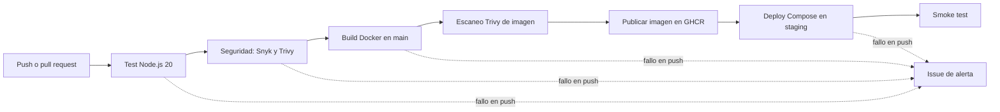

# DevOps 007D OLS

## Descripción del servicio

Microservicio HTTP nativo de Node.js, sin dependencias externas. Expone:

- `GET /`: devuelve un mensaje JSON.
- `GET /health`: devuelve el estado de salud en JSON.
- Otras rutas: responden `404`.

## Pipeline CI/CD

El pipeline está definido en [`.github/workflows/ci-cd.yml`](.github/workflows/ci-cd.yml).



### Jobs

- `test`: se ejecuta en todos los pushes y en los pull requests dirigidos a `main`; corre los tests con el runner nativo de Node, exige al menos 80% de cobertura de líneas y sube el informe HTML como artefacto.
- `security`: depende de `test`; analiza dependencias y código con Snyk y ejecuta Trivy sobre el filesystem. Detecciones `HIGH`/`CRITICAL` bloquean los jobs siguientes.
- `build-scan-push`: solo en push a `main`; construye la imagen con etiquetas OCI, la escanea con Trivy y la publica en GHCR bajo el SHA corto del commit.
- `deploy`: solo después de publicar la imagen; selecciona el entorno GitHub `staging`, descarga esa misma imagen por SHA, la levanta con Compose y ejecuta un smoke test HTTP.
- `alert`: abre un issue automático en GitHub si falla un job previo en un push.

Los jobs `build-scan-push` y `deploy` solo corren en push a `main`; los jobs `test` y `security` corren para todos los pushes y para pull requests dirigidos a `main`.

## Relación con los 10 pasos del encargo

| Paso | Implementación |
|---|---|
| 01. Dockerfile | [Dockerfile](Dockerfile): build multistage, `node:20-alpine`, `USER node`, `EXPOSE` y `HEALTHCHECK`. [.dockerignore](.dockerignore) excluye archivos innecesarios del contexto de construcción. |
| 02. Compose | [compose.yaml](compose.yaml) ejecuta `app`, `nginx` y el servicio de prueba por perfil. |
| 03. Variables | `.env` local basado en [.env.example](.env.example); `.env` está excluido en [.gitignore](.gitignore). |
| 04. Healthchecks | Healthchecks HTTP para `app` y `nginx` en [compose.yaml](compose.yaml). |
| 05. Orden | NGINX usa `depends_on` con `condition: service_healthy` para `app`. |
| 06. Documentación | Este README documenta ejecución, pipeline, calidad y trazabilidad. |
| 07. Volúmenes | NGINX monta [nginx.conf](nginx.conf) como solo lectura; las pruebas montan `./reports` al host. |
| 08. Tests | [test/basic.test.js](test/basic.test.js) cubre `/health`, `/` y 404 con `node:test`. |
| 09. Automatización | `npm test`, servicio Compose `tests` bajo perfil `test` y workflow GitHub Actions. |
| 10. Reporte | [scripts/generate-report.js](scripts/generate-report.js) genera `reports/test-report.html`; Actions lo publica como artefacto. |

El contenedor `tests` es un proceso de ejecución única, no un servidor HTTP. Los healthchecks HTTP aplican a los servicios de larga ejecución (`app` y `nginx`).

## Relación con los indicadores del PDF

La pauta denomina los indicadores `IE1`–`IE5`, ponderados en 20% cada uno:

- **IE1 — Contenedores:** imagen Node Alpine, construcción multistage y ejecución como usuario no root.
- **IE2 — Pruebas automatizadas y calidad:** ejecución automática en CI; el umbral de cobertura de líneas de 80% falla el job si no se cumple.
- **IE3 — Seguridad y escalabilidad:** Dependabot para npm, Docker y GitHub Actions; Snyk para dependencias y código; SonarQube Cloud para calidad de código; Trivy para filesystem e imagen; Compose con varias réplicas y límites de recursos; los fallos bloquean el pipeline y crean una alerta por issue.
- **IE4 — Despliegue y trazabilidad:** publicación en GHCR etiquetada con SHA corto y labels OCI `revision`/`source`; despliegue de la misma etiqueta en `staging` y smoke test.
- **IE5 — Orquestación:** Docker Compose coordina la aplicación, NGINX como proxy/balanceador y el servicio de pruebas. `APP_REPLICAS` configura las réplicas y el workflow aplica tres en staging.

## Política de calidad y seguridad

- Al menos 80% de cobertura de líneas; pruebas fallidas o cobertura insuficiente fallan `npm test` y el job `test`.
- Snyk aplica el umbral `high` a dependencias y análisis de código.
- SonarQube Cloud analiza calidad, mantenibilidad y seguridad estática según `sonar-project.properties`.
- Trivy usa `HIGH,CRITICAL` y `exit-code: 1` para filesystem e imagen.
- Los jobs de build y despliegue dependen del job de seguridad exitoso.
- La imagen se construye sin dependencias de runtime externas y corre como usuario no root.
- La etapa runtime elimina npm y npx, que no son necesarios para ejecutar el servicio; npm permanece disponible en la etapa de pruebas.
- Compose limita memoria/CPU, elimina capabilities y activa `no-new-privileges`; los servicios de aplicación y NGINX usan filesystem de solo lectura.

## Trazabilidad

El SHA corto identifica la imagen publicada en GHCR. La imagen incluye los labels OCI `org.opencontainers.image.revision` y `org.opencontainers.image.source`. El job de despliegue descarga esa imagen por la misma etiqueta y registra el despliegue en el Environment `staging`. El reporte de pruebas queda asociado a la ejecución de Actions como artefacto.

## Ejecución local

Requiere Node.js 20 o superior para ejecutar el proyecto directamente y Docker con Docker Compose para ejecutar el stack contenedorizado.

```bash
# Instalar y verificar el proyecto (no hay dependencias de terceros)
npm ci

# Ejecutar el servicio directamente en http://localhost:3000
npm start

# Ejecutar pruebas, validar cobertura mínima y generar el reporte HTML
npm test

# Generar solamente el reporte HTML de pruebas
npm run test:report

# Configurar variables para Docker Compose
cp .env.example .env

# Construir la imagen
docker build -t devops-007d-ols:latest .

# Levantar la aplicación y NGINX; el escalamiento se indica explícitamente
docker compose up -d --build --scale app="${APP_REPLICAS:-3}"

# Smoke test local a través de NGINX
curl --fail http://localhost:8080/health

# Ejecutar pruebas dentro del contenedor y escribir el reporte en ./reports
docker compose --profile test run --rm tests
```

El servicio directo utiliza `PORT=3000` por defecto. En Docker Compose, NGINX publica el puerto definido por `NGINX_PORT` (por defecto, `8080`) y reenvía las solicitudes al servicio `app`.

En Linux, configura `TEST_UID` y `TEST_GID` en `.env` con los resultados de `id -u` e `id -g` si el proceso de pruebas no tiene permiso para escribir en `./reports`.

### Variables de entorno

Las variables se pueden definir en `.env` a partir de [.env.example](.env.example):

| Variable | Descripción | Valor predeterminado |
|---|---|---|
| `PORT` | Puerto interno del servicio Node.js | `3000` |
| `NODE_ENV` | Entorno de ejecución | `production` |
| `IMAGE_NAME` | Nombre de la imagen Docker de la aplicación | `devops-007d-ols` |
| `IMAGE_TAG` | Etiqueta de la imagen Docker | `latest` |
| `NGINX_PORT` | Puerto publicado por NGINX | `8080` |
| `APP_REPLICAS` | Cantidad configurada de réplicas de `app` | `3` |
| `TEST_UID` | UID usado por el contenedor de pruebas | `1000` |
| `TEST_GID` | GID usado por el contenedor de pruebas | `1000` |

Los scripts disponibles en [package.json](package.json) son:

| Comando | Propósito |
|---|---|
| `npm start` | Inicia el servicio HTTP en el puerto configurado por `PORT`. |
| `npm test` | Ejecuta las pruebas, valida el 80% mínimo de cobertura y genera el reporte HTML. |
| `npm run test:report` | Ejecuta las pruebas y genera `reports/test-report.html` sin aplicar el umbral de cobertura. |

## Preparación de GitHub y staging simulado

Antes de ejecutar el pipeline en GitHub:

1. Configurar el secret de repositorio `SNYK_TOKEN` con un token de Snyk válido. El job `security` falla explícitamente si falta; no omite los escaneos.
2. Crear el GitHub Environment `staging`. El job `deploy` lo usa para identificar el destino de entrega.
3. Dar acceso de lectura y escritura a GitHub Actions para publicar paquetes en GHCR. El workflow usa `GITHUB_TOKEN`; no requiere un token personal para publicar.
4. Habilitar Dependabot alerts y security updates en la configuración del repositorio. Las actualizaciones semanales están declaradas en [.github/dependabot.yml](.github/dependabot.yml).
5. Proteger `main` y exigir los checks `test` y `security` antes de aceptar cambios.
6. Integrar los cambios en `main`. Solo un `push` a esa rama publica la imagen y ejecuta el despliegue simulado.

El job `deploy` levanta Docker Compose y verifica `/health` en el runner de GitHub Actions. Es un entorno cloud simulado y temporal: no es un servicio de staging persistente después de que termina el job. El SHA corto del commit identifica la imagen en GHCR y se reutiliza en el despliegue; los labels OCI guardan el SHA completo y el origen del repositorio.

## Lista de verificación y evidencias para la entrega

La rama de entrega es `main`. Todo el trabajo está integrado en esa rama y el repositorio remoto contiene los cambios.

- [x] La pareja integró el trabajo final en `main` y el repositorio remoto contiene los cambios.
- [x] `SNYK_TOKEN` y `SONAR_TOKEN` configurados como secrets; el Environment `staging` creado; permisos de GHCR habilitados.
- [x] Ejecución exitosa del workflow `CI/CD`: pruebas con cobertura de al menos 80%, análisis Snyk, Trivy y SonarQube Cloud, publicación de imagen en GHCR y despliegue con smoke test.
- [x] Reflexión personal incluida en este README.

## Uso de herramientas de apoyo

Se utilizó GitHub Copilot como apoyo en tareas técnicas, como revisar la configuración del pipeline, mejorar la documentación y comprobar las pruebas. Los integrantes revisan y validan el resultado. Las reflexiones personales sobre el aprendizaje y la contribución son redactadas individualmente por cada integrante.

## Conclusiones y reflexiones individuales

### Reflexión de Angel Venegas

Durante el desarrollo de esta evaluación me enfoqué principalmente en la contenerización y en la arquitectura de orquestación del microservicio. El diseño del Dockerfile con construcción multistage me permitió comprender cómo separar las herramientas de prueba del artefacto final de producción, reduciendo el peso de la imagen y aplicando directivas de seguridad como la ejecución con un usuario no root y la eliminación de binarios innecesarios en la etapa de runtime.

Asimismo, trabajar con Docker Compose para gestionar tres réplicas del servicio coordinadas bajo un balanceador NGINX me demostró la importancia de la alta disponibilidad y el desacoplamiento en sistemas distribuidos. La configuración de comprobaciones de salud (healthchecks) y límites de consumo de recursos tanto en local como en la automatización del pipeline me ayudó a entender cómo se asegura que el tráfico se dirija únicamente a instancias estables y listas para operar.

## Reflexión de Isreel Poblete

Durante el desarrollo de esta evaluación me enfoqué principalmente en la automatización del ciclo de validación y entrega del microservicio. Trabajar con las pruebas de Node.js y establecer un mínimo de 80% de cobertura me permitió comprender la importancia de comprobar que los cambios funcionen antes de integrarlos al proyecto. Además, la configuración de GitHub Actions me ayudó a relacionar las pruebas con los análisis de seguridad de Snyk, Trivy y SonarQube.

También aprendí cómo una imagen Docker puede vincularse directamente con el commit que la originó mediante una etiqueta basada en el SHA. Esto permitió comprender mejor la trazabilidad del proceso, desde el código fuente hasta la publicación en GHCR y el despliegue con Docker Compose. Finalmente, la ejecución del smoke test sobre el endpoint /health reforzó la importancia de validar no solo el código, sino también el funcionamiento de la aplicación una vez desplegada.


