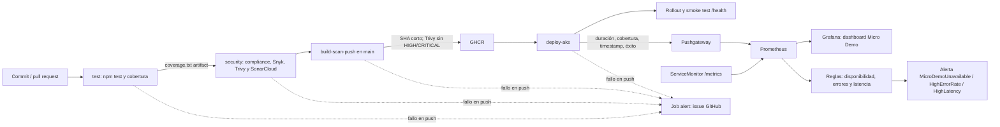

# Observabilidad EP3: entornos reales y decisiones operacionales

## Flujo CI/CD y señales



`deploy-aks` corre solo en un `push` a `main` cuando la variable de repositorio
`AKS_ENABLED` es `true`. El job guarda su hora de inicio como epoch Unix, descarga
el artifact `coverage` publicado por `test`, calcula la duración después del smoke
test y publica los resultados en Pushgateway. Si el rollout o el smoke test fallan,
`ci_last_deploy_success` se publica como `0`; si ambos concluyen correctamente, como `1`.
Un error de Pushgateway o de su ServiceMonitor también queda visible como fallo del job.

El release `pushgateway` usa `prometheus-community/prometheus-pushgateway` versión
`3.11.2`. El nombre del Service generado por la plantilla del chart es
`pushgateway-prometheus-pushgateway`; el workflow comprueba el nombre real en el
clúster. El ServiceMonitor usa el label `release: kube-prometheus-stack` y
`honorLabels: true`, de modo que Prometheus conserve el label de agrupación
`job="ci_cd_micro_demo"` enviado al endpoint
`/metrics/job/ci_cd_micro_demo`.

Métricas publicadas por el pipeline:

| Métrica | Significado |
|---|---|
| `ci_deploy_duration_seconds` | Segundos entre el comienzo del job AKS y la finalización del smoke test. |
| `ci_test_coverage_percent` | Porcentaje de cobertura de líneas del artifact `coverage`. |
| `ci_last_deploy_timestamp_seconds` | Epoch Unix de fin de la ejecución de despliegue. |
| `ci_last_deploy_success` | `1` si rollout y smoke test pasaron; `0` en otro caso. |

## Herramientas, etapa y decisión

| Herramienta | Etapa del pipeline | Métrica o control | Decisión técnica que habilita |
|---|---|---|---|
| Node Test Runner | `test` | Cobertura de líneas en `reports/coverage.txt` | Si cobertura <80%, el job falla y la protección de rama impide integrar el cambio. |
| Snyk | `security` | Vulnerabilidades HIGH/CRITICAL en dependencias y código | No se autoriza el build y publicación mientras exista una vulnerabilidad sobre el umbral. |
| Trivy | `security` y `build-scan-push` | Filesystem e imagen; severidades HIGH/CRITICAL con `exit-code: "1"` | Si Trivy encuentra HIGH/CRITICAL, no se publica la imagen en GHCR. |
| SonarQube Cloud | `security` | Calidad y análisis estático del cambio | Informa hallazgos del código antes de integrar; revisar el Quality Gate configurado en el repositorio. |
| `validate-compliance.js` | `security` | Tag de imagen, recursos, usuario no root, probes y umbrales de análisis | Cualquier control ausente o inválido hace fallar `security`. |
| GitHub Actions | `test`, `security`, `build-scan-push`, `deploy-aks` | Estados de jobs y artifact de cobertura | Los jobs posteriores requieren los predecesores exitosos; checks fallidos bloquean el merge cuando la protección manual esté habilitada. |
| kube-prometheus-stack | `deploy-aks` y operación | `up`, errores HTTP, P95, CPU y memoria por pod | Si P95 >1 s, investigar carga, errores, recursos y logs; considerar rollback si el cambio coincide con la degradación. |
| Pushgateway | Fin de `deploy-aks` | Duración, cobertura, timestamp y resultado del despliegue | Comparar cambios del pipeline con tendencias y comprobar que el último despliegue terminó correctamente. |
| PrometheusRule | Operación | `MicroDemoUnavailable`, `MicroDemoHighErrorRate`, `MicroDemoHighLatency` | Si `MicroDemoUnavailable` se mantiene, diagnosticar el rollout y revertir con `kubectl rollout undo`. |

El dashboard está en [`k8s/grafana-dashboard.yaml`](../k8s/grafana-dashboard.yaml)
y conserva las cuatro señales existentes (solicitudes/s, errores/s, P95 y memoria RSS).
Agrega CPU y memoria de trabajo por pod, duración del último despliegue, gauge de cobertura
(rojo bajo 80%), errores HTTP de la última hora y disponibilidad basada en `up`.
El ServiceMonitor de la aplicación está en
[`k8s/servicemonitor.yaml`](../k8s/servicemonitor.yaml) y las reglas en
[`k8s/prometheus-rules.yaml`](../k8s/prometheus-rules.yaml).

## Runbook ante alertas

Ejecutar los comandos desde una sesión autenticada al clúster correcto. No incluir
tokens, kubeconfigs ni contraseñas en issues o capturas.

### Diagnóstico inicial

```bash
kubectl config current-context
kubectl get deployments,pods,services -n devops-staging -o wide
kubectl rollout status deployment/micro-demo -n devops-staging --timeout=180s
kubectl describe deployment micro-demo -n devops-staging
kubectl get events -n devops-staging --sort-by=.lastTimestamp
kubectl get servicemonitor,prometheusrule -A
```

Comprobar el ServiceMonitor del Pushgateway y la retención del label `job`:

```bash
kubectl get service pushgateway-prometheus-pushgateway -n monitoring
kubectl get servicemonitor pushgateway-prometheus-pushgateway -n monitoring \
  -o jsonpath='{.metadata.labels.release}{" honorLabels="}{.spec.endpoints[0].honorLabels}{"\n"}'
```

La salida esperada es `kube-prometheus-stack honorLabels=true`. Si no coincide,
el job de despliegue está diseñado para fallar en la verificación.

### `MicroDemoUnavailable`

1. Revisar Pods, eventos y endpoints del Service:

   ```bash
   kubectl get pods -n devops-staging -l app.kubernetes.io/name=micro-demo -o wide
   kubectl describe pods -n devops-staging -l app.kubernetes.io/name=micro-demo
   kubectl get endpoints micro-demo -n devops-staging
   ```

2. Revisar logs. Si la versión recién desplegada no es saludable y la revisión anterior
   estaba estable, registrar la revisión y revertir:

   ```bash
   kubectl rollout history deployment/micro-demo -n devops-staging
   kubectl rollout undo deployment/micro-demo -n devops-staging
   kubectl rollout status deployment/micro-demo -n devops-staging --timeout=180s
   ```

3. Confirmar que el servicio responde y volver a observar `up`:

   ```bash
   kubectl get pods,service -n devops-staging -o wide
   kubectl get events -n devops-staging --sort-by=.lastTimestamp
   ```

### `MicroDemoHighErrorRate` o `MicroDemoHighLatency`

Comparar errores, P95 y señales de recursos del dashboard; luego inspeccionar Pods,
probes y logs de la ventana afectada:

```bash
kubectl top pods -n devops-staging
kubectl describe deployment micro-demo -n devops-staging
kubectl logs -n devops-staging -l app.kubernetes.io/name=micro-demo \
  --all-containers=true --since=15m --prefix=true
```

No ejecutar un rollback solo por una muestra aislada: verificar primero que la alerta
persista y que el cambio desplegado coincida temporalmente con la degradación. Si la
disponibilidad se afecta, aplicar el procedimiento de `MicroDemoUnavailable`.

### Consulta manual de métricas CI/CD

```bash
kubectl port-forward -n monitoring service/pushgateway-prometheus-pushgateway 9091:9091
curl --fail http://127.0.0.1:9091/metrics
```

Buscar `ci_deploy_duration_seconds`, `ci_test_coverage_percent`,
`ci_last_deploy_timestamp_seconds` y `ci_last_deploy_success`. Pushgateway expone
estas métricas de CI/CD; `/metrics` del microservicio contiene las señales de aplicación.

## Logs y correlación por request ID

Cada respuesta HTTP incluye `X-Request-ID`. Si la solicitud envía un `X-Request-ID`
no vacío, el servicio lo conserva; de lo contrario genera un UUID. Los logs JSON
`http_request` y `http_request_error` incluyen el campo `request_id`, método, ruta,
código y duración cuando aplica.

Consultar logs recientes de todos los Pods y seguir un identificador observado en
la cabecera de la respuesta:

```bash
kubectl logs -n devops-staging -l app.kubernetes.io/name=micro-demo \
  --all-containers=true --since=30m --prefix=true
kubectl logs -n devops-staging -l app.kubernetes.io/name=micro-demo \
  --all-containers=true --since=30m --prefix=true \
  | grep '"request_id":"<REQUEST_ID>"'
```

Para una prueba manual:

```bash
curl --include http://<IP-DEL-SERVICE>/health
curl --include -H 'X-Request-ID: ep3-demo-001' http://<IP-DEL-SERVICE>/health
```

No copiar valores personales o encabezados de autenticación en la evidencia. Usar
únicamente el `request_id` sintético de la prueba.
